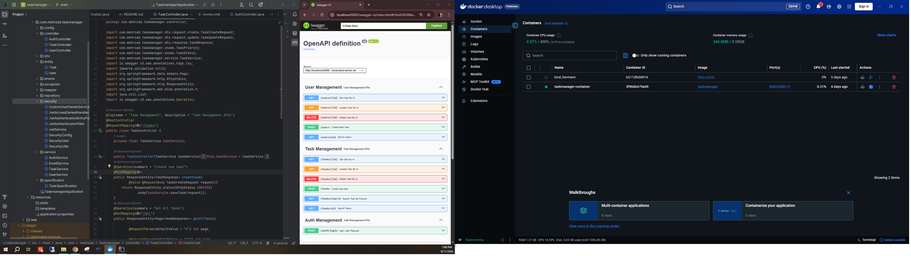
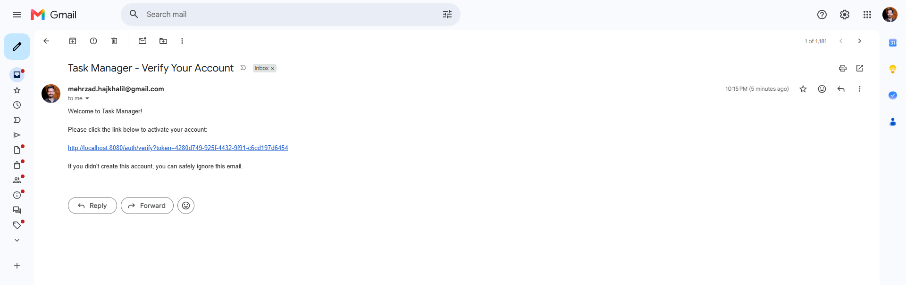

# 📌 Task Manager API

A production-style Task Management REST API built with **Spring Boot 3** following clean architecture principles and best practices.

This project demonstrates modern backend development concepts including authentication, authorization, email verification, Docker, and Oracle Database integration.

---

# 🚀 Features

## Authentication & Security

- JWT Authentication
- BCrypt Password Encryption
- Email Verification
- Asynchronous Email Sending
- Role-Based Authorization (ADMIN / USER)
- Stateless Authentication with Spring Security

---

## User Management

- Register User
- Login
- Update User
- Delete User
- Get User By Id
- Get All Users

---

## Task Management

- Create Task
- Update Task
- Delete Task
- Search Tasks
- Pagination
- Sorting
- Dynamic Filtering using JPA Specifications

---

## Validation & Exception Handling

- Bean Validation
- Global Exception Handler
- Custom Business Exceptions
- Consistent Error Response Structure

---

## Documentation

- Swagger UI
- OpenAPI 3

---

## Database

- Oracle Database
- Spring Data JPA
- Hibernate
- Optimistic Locking (@Version)

---

## DevOps

- Dockerized Application
- Docker Image
- Docker Container
- Oracle Connectivity inside Docker

---

# 🛠 Tech Stack

- Java 17
- Spring Boot 3
- Spring Security
- Spring Data JPA
- Hibernate
- Oracle Database
- JWT
- Lombok
- Maven
- Docker
- Swagger / OpenAPI

---

# 📂 Project Structure

```
src
 ├── controller
 ├── service
 ├── repository
 ├── entity
 ├── dto
 ├── mapper
 ├── security
 ├── exception
 ├── specification
 └── config
```

---

# 📖 API Documentation

Swagger UI

```
http://localhost:8080/swagger-ui/index.html
```

---

# 🐳 Docker

Build Image

```bash
docker build -t taskmanager .
```

Run Container

```bash
docker run -d -p 8080:8080 taskmanager
```

---

# 🔐 Authentication Flow

```text
Register
      │
      ▼
Verification Email
      │
      ▼
Click Verification Link
      │
      ▼
Account Activated
      │
      ▼
Login
      │
      ▼
JWT Token
      │
      ▼
Authorized Requests
```

---

# 📸 Screenshots

## 🔹 Dockerized Application

The application is successfully containerized using Docker and runs with Oracle Database connectivity.

<p align="center">
  
</p>

---

## 🔹 Email Verification

After user registration, a verification email is sent automatically. The account becomes active only after clicking the verification link.

<p align="center">
  
</p>

# Future Improvements

- Refresh Token
- Forgot Password
- Reset Password
- Unit Testing
- Integration Testing
- CI/CD Pipeline

---

# Author

**Mehrzad Hajkhalil**

Java Backend Developer

GitHub

https://github.com/mehrzadmh